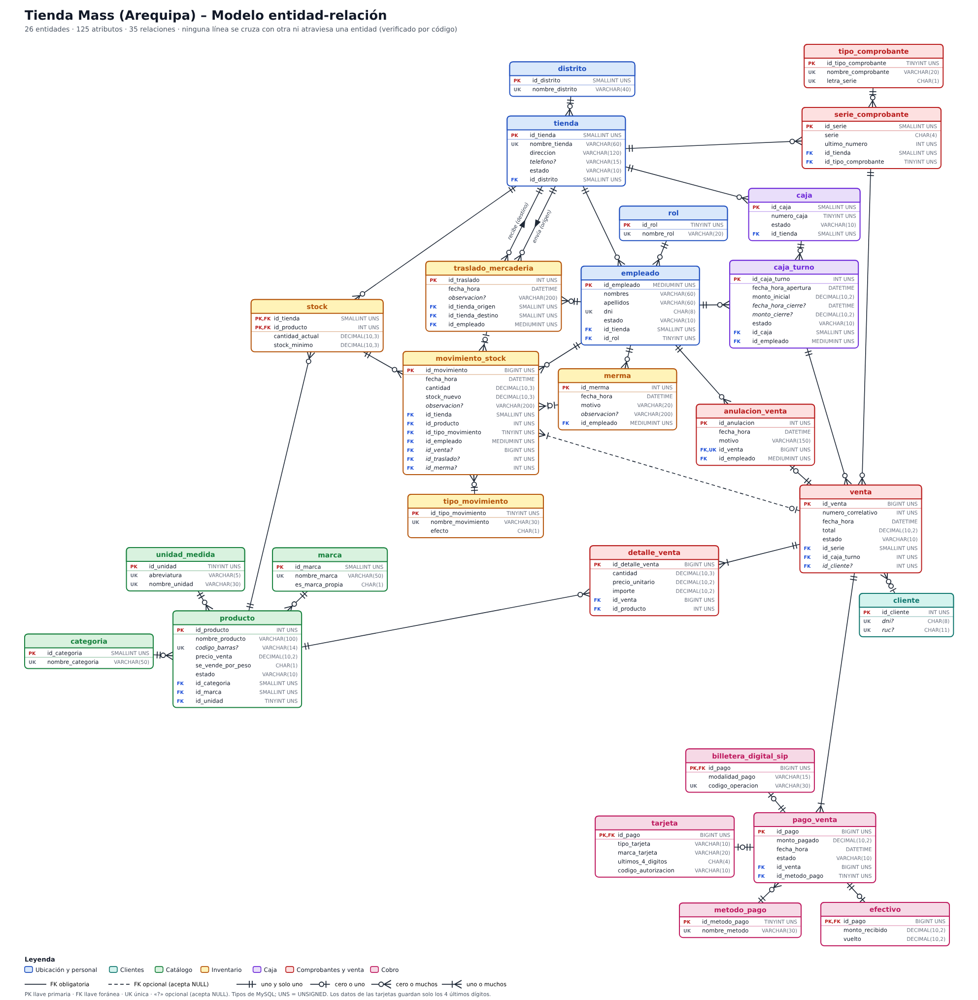

# Minimarket Mass

Sistema de ventas e inventario para **Tienda Mass** (grupo Intercorp), un supermercado que atiende solo de forma presencial, con **3 tiendas en Arequipa**: Cayma, Cerro Colorado y Yanahuara. Proyecto académico en **PHP 8** con arquitectura **MVC** y base de datos **MySQL**.

La base de datos es el centro del proyecto: **31 tablas, 46 relaciones**, reglas de negocio verificables con consultas y un diagrama entidad-relación en notación *Crow's Foot*.

---

## Contenido

1. [Qué hace el sistema](#qué-hace-el-sistema)
2. [Alcance](#alcance)
3. [Tecnologías](#tecnologías)
4. [Estructura del proyecto](#estructura-del-proyecto)
5. [Base de datos](#base-de-datos)
6. [Reglas de negocio](#reglas-de-negocio)
7. [Roles de los empleados](#roles-de-los-empleados)
8. [Instalación y ejecución](#instalación-y-ejecución)
9. [Rutas disponibles](#rutas-disponibles)
10. [Datos de prueba](#datos-de-prueba)
11. [Consultas incluidas](#consultas-incluidas)
12. [Documentación](#documentación)
13. [Limitaciones conocidas](#limitaciones-conocidas)
14. [Autor](#autor)

---

## Qué hace el sistema

- **Catálogo:** productos con categoría, marca, unidad de medida y un precio único para todas las tiendas.
- **Inventario por tienda:** el stock de cada producto en cada sucursal, con un historial completo (*kardex*) de cada cambio.
- **Lotes y vencimientos:** los productos perecibles (leche, yogurt) se controlan por lote y se vende primero el que vence antes.
- **Venta en caja:** turnos de caja, boletas y facturas con serie y correlativo por tienda, y detalle de productos.
- **Cobro:** una venta puede pagarse con varios métodos a la vez: **efectivo, tarjeta y billetera digital Sip**.
- **Devoluciones:** devolución parcial de productos de una venta; el producto vuelve al stock y el dinero sale de la caja.
- **Movimientos de caja:** ingresos de sencillo, retiros de seguridad, gastos y devoluciones de dinero, para cuadrar el efectivo del turno.
- **Traslados y mermas:** movimiento de mercadería entre tiendas y registro de pérdidas (vencido, dañado).
- **Módulo del administrador:** autoriza o rechaza las anulaciones que pide el cajero, programa los turnos de trabajo de su tienda y registra los traslados.
- **Empleados y clientes:** el empleado entra con su DNI y su contraseña; del cliente solo se guarda DNI o RUC.

## Alcance

**Incluido:** hasta 3 sucursales, venta presencial, boleta y factura, pagos con efectivo, tarjeta y Sip.

**Fuera de alcance (a propósito):** compras a proveedores (no existe la entidad proveedor), guías de remisión, facturación electrónica, puntos y promociones, Yape y Plin (no se aceptan en las tiendas Mass), y el IGV: el precio y el total de la venta son los finales.

## Tecnologías

| Componente | Detalle |
|---|---|
| Lenguaje | PHP 8 con PDO |
| Patrón | MVC (controladores, modelos, vistas) |
| Base de datos | **MySQL 8.0.16 o superior** (desde esa versión se aplican los `CHECK`; antes se aceptaban y se ignoraban) |
| Motor y codificación | InnoDB, `utf8mb4` |
| Servidor local | XAMPP, Laragon o el servidor integrado de PHP |
| Contraseñas | Hash bcrypt (`password_hash` / `password_verify`) |

## Estructura del proyecto

```
minimarket_mass/
├── controllers/      # Lógica de cada pantalla
│   ├── AuthController.php       # Inicio de sesión (DNI + contraseña)
│   ├── ProductoController.php   # Lista de productos
│   ├── StockController.php      # Stock por tienda
│   └── VentaController.php      # Boleta de una venta
├── models/           # Entidades y repositorios de acceso a datos
│   ├── Database.php             # Conexión PDO
│   ├── Empleado.php             # Clase base de los roles
│   ├── Administrador.php        # Rol administrador
│   ├── Cajero.php               # Rol cajero
│   ├── Almacenero.php           # Rol almacenero
│   ├── EmpleadoRepository.php   # Autenticación y consulta de empleados
│   ├── Producto.php / ProductoRepository.php
│   ├── StockRepository.php
│   └── Venta.php / VentaRepository.php
├── views/            # Pantallas: auth/, productos/, stock/, ventas/
├── public/           # Único punto de entrada web (index.php) + css/, js/, img/
├── database/         # Scripts SQL (ver abajo)
│   ├── schema.sql    # Estructura: crea la base y las 31 tablas
│   ├── datos.sql     # Datos de ejemplo (ficticios)
│   ├── consultas.sql # Consultas del negocio y de control de reglas
│   └── boleta.sql    # Vista vw_comprobante y procedimiento sp_boleta
├── docs/             # Diseño de la base de datos y diagrama ER
├── .env.example      # Plantilla de datos de conexión
└── README.md
```

## Base de datos

### Scripts y orden de ejecución

| Orden | Archivo | Qué hace |
|---|---|---|
| 1 | `database/schema.sql` | Crea la base `minimarket_mass` y sus 31 tablas. **Borra la base si ya existía.** |
| 2 | `database/datos.sql` | Inserta datos de ejemplo que respetan todas las reglas de negocio. |
| 3 | `database/consultas.sql` | 26 consultas del negocio y 19 consultas de control de reglas. |
| 4 | `database/boleta.sql` | Vista `vw_comprobante` y procedimiento `sp_boleta` para mostrar una boleta o factura. |

### Las 31 tablas por módulo

| Módulo | Tablas |
|---|---|
| **Ubicación y personal** | `distrito`, `tienda`, `rol`, `empleado`, `turno_trabajo` |
| **Clientes** | `cliente` |
| **Catálogo** | `categoria`, `marca`, `unidad_medida`, `producto` |
| **Inventario** | `stock`, `lote_producto`, `tipo_movimiento`, `movimiento_stock` (kardex), `traslado_mercaderia`, `merma` |
| **Caja** | `caja`, `caja_turno`, `movimiento_caja` |
| **Comprobantes y venta** | `tipo_comprobante`, `serie_comprobante`, `venta`, `detalle_venta`, `solicitud_anulacion`, `devolucion_venta`, `detalle_devolucion` |
| **Cobro** | `metodo_pago`, `pago_venta`, `efectivo`, `tarjeta`, `billetera_digital_sip` |

### Decisiones de diseño importantes

- **La venta no guarda su tienda, su caja ni su cajero.** Se obtienen de la serie del comprobante (que pertenece a una tienda) y del turno de caja (que tiene la caja y el cajero). Así no puede existir una venta con una tienda y una caja de otra.
- **Serie y correlativo separados.** `serie_comprobante` guarda la serie por tienda y su último número; `venta` guarda solo el correlativo, con `UNIQUE (id_serie, numero_correlativo)`.
- **Kardex único.** `movimiento_stock` registra todo cambio de stock y un `CHECK` obliga a que tenga **exactamente un origen**: una venta, un traslado, una merma o una devolución.
- **Pagos con subtipos.** `pago_venta` guarda lo común y cada método tiene su tabla (`efectivo`, `tarjeta`, `billetera_digital_sip`) cuya llave primaria es también llave foránea del pago. De la tarjeta solo se guardan los **últimos 4 dígitos**.
- **Anulación con autorización.** `solicitud_anulacion` registra quién pidió la anulación, quién la resolvió y el resultado (PENDIENTE, APROBADA, RECHAZADA). Solo puede aprobarse una vez por venta.
- **Turno de trabajo ≠ turno de caja.** `caja_turno` controla el dinero de una caja; `turno_trabajo` es el horario que programa el administrador a cualquier empleado.
- **Nada se borra.** No hay `ON DELETE CASCADE`: ventas, pagos y movimientos son historial. Lo que deja de usarse cambia de estado.
- **Estados con `VARCHAR` + `CHECK`** en lugar de `ENUM`, para leerlos mejor y cambiarlos sin alterar el tipo de la columna.
- **Tipos:** dinero en `DECIMAL(10,2)`, cantidades y kilos en `DECIMAL(10,3)`, y cada llave foránea con el mismo tipo (incluido `UNSIGNED`) que la llave primaria a la que apunta.

### Diagrama entidad-relación



Notación *Crow's Foot*: 31 entidades y 46 relaciones, con las líneas trazadas sin cruzarse entre sí ni atravesar una entidad. Línea continua = llave foránea obligatoria; línea discontinua = llave foránea opcional. Versión vectorial: [`docs/diagrama_er.svg`](docs/diagrama_er.svg).

## Reglas de negocio

Cada regla se garantiza en la base de datos (**BD**: llaves, `UNIQUE`, `CHECK`, `NOT NULL`) o en el proceso (**Proceso**: se verifica con una consulta de control que debe devolver 0 filas). Resumen:

| Regla | Dónde se garantiza |
|---|---|
| 3 tiendas en Arequipa, cada una en un distrito | BD |
| Métodos de pago: solo efectivo, tarjeta y billetera digital Sip | BD |
| Serie con 4 caracteres (`B001`, `F001`) y correlativo propio por tienda | BD |
| Serie + correlativo no se repiten; el correlativo avanza de uno en uno | BD y Proceso |
| La factura exige un cliente con RUC; la boleta puede ir sin cliente | Proceso |
| DNI de 8 dígitos y RUC de 11; un cliente tiene DNI, RUC o ambos | BD |
| El stock es por tienda y nunca es negativo | BD |
| Cada cambio de stock deja un movimiento en el kardex | Proceso |
| Las ventas nunca se borran: EMITIDA o ANULADA | BD |
| La anulación la **solicita el cajero** de la venta y la **autoriza o rechaza el administrador de la misma tienda**; solo se aprueba una vez | BD y Proceso |
| Los pagos válidos de una venta suman su total | Proceso |
| El cajero vende solo con un turno de caja abierto, en una caja de su tienda | Proceso |
| El traslado va de una tienda origen a otra destino distinta y lo registra el administrador de la tienda de origen | BD y Proceso |
| El administrador programa los turnos de trabajo de los empleados de su tienda: un turno por empleado y día | BD y Proceso |
| El cajero abre su turno de caja solo un día en que tiene turno de trabajo y dentro de su horario | Proceso |
| El precio es único para todas las tiendas; el detalle guarda una copia del precio al vender | BD |
| Productos perecibles con lote: se vende primero el lote que vence antes, nunca uno vencido | Proceso |
| La devolución es parcial, sobre una venta emitida, y no supera lo vendido | BD y Proceso |
| Monto de cierre de turno = inicial + efectivo cobrado + ingresos − retiros − gastos − devoluciones | Proceso |

Las 30 reglas completas, con su justificación, están en [`docs/diseno_bd.md`](docs/diseno_bd.md).

## Roles de los empleados

Cada empleado pertenece a **una tienda** y tiene **un rol**.

| Rol | Qué hace |
|---|---|
| **Administrador** | Autoriza o rechaza las solicitudes de anulación de ventas de su tienda, programa los turnos de trabajo de sus empleados y registra los traslados de mercadería que salen de su tienda. |
| **Cajero** | Abre su turno de caja, vende (boleta o factura), registra pagos y solicita la anulación de una venta. |
| **Almacenero** | Registra las mermas de su tienda y recibe la mercadería de los traslados. |

## Instalación y ejecución

### Requisitos

- PHP 8 o superior con la extensión `pdo_mysql`
- MySQL 8.0.16 o superior
- Git

### Pasos

1. Clona el repositorio:
   ```bash
   git clone https://github.com/ger-commits/minimarket_mass.git
   cd minimarket_mass
   ```

2. Crea la base de datos importando los scripts **en este orden**:
   ```bash
   mysql -u root -p < database/schema.sql
   mysql -u root -p < database/datos.sql
   mysql -u root -p < database/boleta.sql
   ```
   (`consultas.sql` es opcional: son consultas para ejecutar y revisar.)

3. Revisa los datos de conexión en `models/Database.php` (por defecto `root` sin contraseña en `localhost`, base `minimarket_mass`). El archivo `.env.example` es la plantilla de esos datos para quien quiera pasarlos a un `.env`; el `.env` está en `.gitignore` y no se sube a GitHub.

4. Inicia el servidor desde la raíz del proyecto:
   ```bash
   php -S localhost:8000 -t public
   ```

5. Abre `http://localhost:8000`.

> Si usas XAMPP o Laragon, también puedes importar los `.sql` desde phpMyAdmin respetando el mismo orden.

## Rutas disponibles

Todas entran por `public/index.php` y eligen el controlador según el parámetro `r`.

| Ruta | Qué muestra |
|---|---|
| `index.php?r=login` | Inicio de sesión con el DNI y la contraseña del empleado |
| `index.php?r=productos` | Lista de productos |
| `index.php?r=stock&tienda=1` | Stock de una tienda (1 = Cayma, 2 = Cerro Colorado, 3 = Yanahuara) |
| `index.php?r=boleta&serie=B001&n=1` | Boleta o factura de una venta |

## Datos de prueba

`datos.sql` carga datos **ficticios** (DNI, RUC, teléfonos, códigos de barras, precios y contraseñas inventados):

- 3 tiendas, 9 empleados (un administrador, un cajero y un almacenero por tienda), 12 productos y 14 ventas (boletas y facturas).
- Una venta anulada, con su solicitud aprobada; una solicitud rechazada y otra pendiente.
- Pagos con uno y con dos métodos, devoluciones, mermas, un traslado entre tiendas y lotes con vencimiento.
- Turnos de trabajo programados para los 9 empleados.

| Empleado | DNI | Rol | Tienda |
|---|---|---|---|
| Rosa Quispe Huaman | `70000001` | Administrador | Cayma |
| Luis Caceres Pinto | `70000002` | Cajero | Cayma |
| Carmen Ccori Flores | `70000003` | Almacenero | Cayma |
| Jorge Mendoza Salas | `70000004` | Administrador | Cerro Colorado |
| Ana Valdivia Rojas | `70000005` | Cajero | Cerro Colorado |
| Pedro Choque Ramos | `70000006` | Almacenero | Cerro Colorado |
| Lucia Zegarra Paredes | `70000007` | Administrador | Yanahuara |
| Miguel Nunez Cuadros | `70000008` | Cajero | Yanahuara |
| Sofia Linares Avila | `70000009` | Almacenero | Yanahuara |

La contraseña de prueba de todos es `Mass2026`. En la base se guarda solo su **hash bcrypt**, nunca el texto. Cambia estas contraseñas si algún día usas el sistema fuera de un entorno de práctica.

## Consultas incluidas

`database/consultas.sql` está dividido en secciones:

- **A. Catálogo y personal:** productos con categoría y marca, empleados por tienda y rol.
- **B. Inventario:** stock por tienda, productos bajo el mínimo, kardex, traslados, mermas y lotes por vencer.
- **C. Ventas y cobro:** comprobantes, ventas por día y tienda, productos más vendidos, ventas con pagos múltiples y anulaciones (quién pidió y quién autorizó).
- **D. Caja:** cuadre de cada turno, movimientos de caja y devoluciones.
- **F. Control de reglas:** consultas que **deben devolver 0 filas** si los datos cumplen las reglas (pagos que no suman el total, factura sin RUC, correlativos con huecos, stock distinto del kardex, anulaciones incoherentes, y más).
- **H. Módulo del administrador:** bandeja de solicitudes pendientes de su tienda, rol de turnos programados, solicitudes por estado y controles de turnos y traslados.

El procedimiento `sp_boleta` (en `boleta.sql`) muestra un comprobante completo a partir de su serie y número:

```sql
CALL sp_boleta('B001', 1);
```

## Documentación

- [`docs/diseno_bd.md`](docs/diseno_bd.md): **fuente única del diseño.** Describe cada tabla (columnas, tipos, llaves, restricciones), las 46 relaciones con su cardinalidad, las 30 reglas de negocio y las decisiones de diseño con su porqué.
- [`docs/diagrama_er.png`](docs/diagrama_er.png) y [`docs/diagrama_er.svg`](docs/diagrama_er.svg): diagrama entidad-relación.

## Limitaciones conocidas

- La aplicación PHP es un **esqueleto**: tiene inicio de sesión, lista de productos, stock por tienda y boleta. Las pantallas del cajero (venta), del administrador (bandeja de anulaciones, turnos) y del almacén aún no están construidas; la base de datos ya las soporta.
- `models/Database.php` tiene los datos de conexión escritos en el código; todavía no lee el `.env`.
- Los scripts SQL se validaron con una emulación en SQLite y no se ejecutaron en un servidor MySQL real. Si encuentras algún error al importarlos en MySQL 8.0.16 o superior, revisa primero ese punto.

## Autor

[ger-commits](https://github.com/ger-commits)
